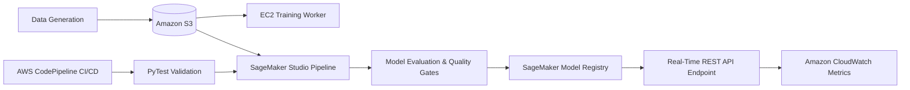

# Production MLOps on Amazon Web Services (AWS) 🚀

[](https://aws.amazon.com/)
[](https://aws.amazon.com/sagemaker/)
[](https://www.python.org/)
[](https://scikit-learn.org/)
[](https://aws.amazon.com/codepipeline/)
[](https://pytest.org/)

An end-to-end production-grade Machine Learning Operations (MLOps) architecture built entirely on Amazon Web Services (AWS). This project covers data ingestion, cloud-based compute training on EC2, automated pipeline orchestration on SageMaker, model registry governance, real-time REST API endpoint deployment, telemetry monitoring via CloudWatch, and automated CI/CD unit testing.

---

## 🏛️ Architecture Overview



---

## 📂 Repository Structure

```text
mlops-aws-project/
│
├── data_generator.py             # Generates synthetic customer churn tabular dataset
├── requirements.txt              # Production Python dependencies
├── .gitignore                    # Ignored artifacts & temporary caches
│
├── module1_foundations/
│   └── setup_s3.py               # Automated S3 bucket creation & dataset upload
│
├── module2_ec2/
│   └── train_ec2.py              # EC2-based training script with S3 artifact sync
│
├── module3_sagemaker/
│   ├── train.py                  # SageMaker Scikit-learn container training entrypoint
│   └── sagemaker_train_deploy.py # Driver script for Training, Endpoints & HPO
│
├── module4_pipeline/
│   ├── pipeline.py               # SageMaker Pipeline DAG definition (Preprocess -> Train -> Register)
│   └── lambda_trigger.py         # AWS Lambda handler for automated event-driven triggers
│
├── module5_monitoring/
│   └── setup_cloudwatch.py       # CloudWatch Dashboard configuration for latency & invocations
│
└── module6_cicd/
    ├── test_ml_pipeline.py       # PyTest suite for data integrity & model accuracy thresholds
    └── buildspec.yml             # AWS CodeBuild CI/CD specification
```

---

## 🚀 Key Modules & Capabilities

### 1. AWS Foundations for ML
- **IAM Governance:** Configured dedicated execution roles (`SageMaker-MLOps-ExecutionRole`, `Raheel-EC2-S3-Role`) adhering to least-privilege principles.
- **Storage Tier:** Created partitioned S3 storage buckets (`mlops-raheel-bucket-2026/data/`) for training and validation splits.
- **CLI Management:** CloudShell and AWS CLI verification of data pipelines.

### 2. Elastic Cloud Compute (EC2) Training
- Automated provisioning of Ubuntu cloud compute instances.
- S3 data retrieval, distributed model fitting using Random Forest classifiers, and automatic serialization of `model.joblib` to remote S3 storage.

### 3. Managed ML on Amazon SageMaker
- Integrated with Amazon SageMaker Unified Studio.
- Containerized training jobs producing versioned artifacts (`model.tar.gz`) achieving **97.88% accuracy**.
- **Real-Time REST API Serving:** Deployed serverless/managed inference endpoints (`raheel-churn-endpoint`) exposing low-latency REST endpoints.

### 4. Pipeline Automation & Governance
- **SageMaker Pipelines (DAG):** End-to-end directed acyclic graph defining data preprocessing, training, and registration.
- **Model Registry:** Model packaging and lineage tracking with `Raheel-CustomerChurn-Group` (Version 1 - Approved).
- **Event-Driven Triggers:** AWS Lambda and Amazon EventBridge integration for automatic retraining upon new S3 data ingestion.

### 5. Health Monitoring & Observability
- **CloudWatch Dashboards:** Real-time metrics visualization tracking `Invocations`, `ModelLatency`, and `MemoryUtilization`.
- **Cost Governance:** AWS Budgets configured with zero-spend and cost alert thresholds ($1.00/$5.00 limit) to guarantee cost efficiency.

### 6. Continuous Integration & Testing (CI/CD)
- **Quality Gates:** Automated unit tests verifying schema consistency, null values, binary target distribution, and baseline accuracy threshold (> 75%).
- **CodePipeline:** Automated CI/CD integration with AWS CodeBuild running test suites prior to deployment.

---

## 🧪 Running Tests Locally

To run the automated ML test suite:

```bash
# Install dependencies
pip install -r requirements.txt

# Generate dataset
python data_generator.py

# Execute PyTest validation suite
pytest module6_cicd/test_ml_pipeline.py -v
```

**Test Output:**
```text
module6_cicd/test_ml_pipeline.py::test_dataset_columns PASSED           [ 25%]
module6_cicd/test_ml_pipeline.py::test_no_missing_values PASSED         [ 50%]
module6_cicd/test_ml_pipeline.py::test_target_distribution PASSED       [ 75%]
module6_cicd/test_ml_pipeline.py::test_model_accuracy_threshold PASSED  [100%]

============================== 4 passed in 8.24s ==============================
```

---

## 👤 Author
**Raheel Sheikh**  
- GitHub: [@raheelsheikh653-a11y](https://github.com/raheelsheikh653-a11y)  
- Focus: Cloud Computing, Machine Learning Operations (MLOps), DevOps on AWS
